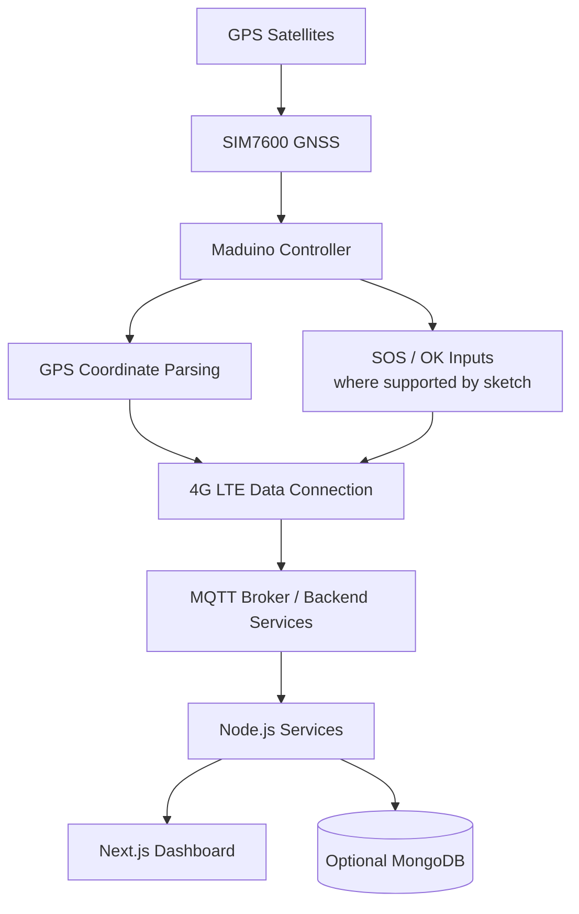

<div align="center">

# 🚗 GPS Vehicle Tracking System
### Maduino Zero 4G LTE • SIM7600 • MQTT • Web Dashboard

**TRACK · LOCATE · ALERT · MONITOR**

An embedded vehicle-tracking prototype that brings together GPS positioning, cellular connectivity, MQTT messaging, and a web-based monitoring interface.


</div>

---

## 📍 Project at a glance

| Area | Implementation represented in this repository |
|---|---|
| Embedded controller | Maduino Zero 4G LTE / SIM7600-based board |
| Positioning | SIM7600 GNSS commands and GPS coordinate parsing |
| Cellular link | 4G LTE / packet-data configuration |
| Messaging | MQTT tracking and alert topics in relevant firmware variants |
| Backend | Node.js services using MQTT, UDP, HTTP and socket communication |
| Dashboard | Next.js frontend with map-related interface assets |
| Optional storage | MongoDB relay service; Supabase client configuration in frontend |

> **Project scope:** This repository contains multiple firmware iterations and supporting backend/frontend source. It is an academic prototype, not a verified, production-ready fleet-tracking service. End-to-end behavior depends on which firmware sketch and server components are configured together.

## ✨ Capabilities in the supplied source

- 📡 **GPS acquisition** — reads SIM7600 GPS information using commands such as `AT+CGPSINFO`.
- 🧭 **Coordinate conversion** — converts GPS degrees/minutes values into decimal-degree coordinates.
- 🌐 **Cellular connectivity** — configures packet-data access using an APN setting.
- 📨 **MQTT messaging** — publishes or handles tracking, SOS, and OK topics in the relevant firmware variant.
- 🖥️ **Monitoring interface** — includes a Next.js dashboard and map-related assets.
- 🔁 **Backend services** — includes Node.js services for MQTT, UDP, HTTP and socket-based data handling.
- 🗄️ **Optional persistence** — includes a relay service that can use MongoDB when configured.

## 🧩 System architecture



<sub>Conceptual architecture based on the supplied source files. The exact data path varies by firmware and backend service selected.</sub>

## 🛠️ Hardware

- Maduino Zero 4G LTE / SIM7600-based development board
- Compatible SIM card and cellular antenna
- GPS/GNSS antenna, as required by the board/module
- SOS and OK switches for the firmware variant that supports those inputs
- Suitable regulated power supply

**Before powering the hardware:** confirm the exact board revision, antenna connectors, pin mapping, supply voltage/current requirements, and wiring against the board documentation.

## 💻 Software and tools

| Tool / technology | Purpose |
|---|---|
| Arduino IDE | Firmware editing and upload |
| SIM7600 AT commands | GNSS and modem control |
| TinyGSM / PubSubClient | Used by relevant firmware variants for modem/MQTT functionality |
| Node.js + npm | Backend runtime and package management |
| Next.js / React | Dashboard interface |
| MQTT broker | Message transport |
| MongoDB | Optional backend persistence |
| Supabase | Frontend client integration, if that feature is used |

Install only the Arduino libraries required by the specific sketch you choose. The firmware variants are separate iterations and should not be compiled together.

## 📂 Repository layout

```text
gps-vehicle-tracking-system/
├── firmware/
│   ├── Blueband_final/
│   ├── Blueband_with_serial/
│   └── MADUINO_GPS/
├── backend/
│   ├── car44.js
│   ├── relay_server.js
│   ├── udp_server.js
│   ├── package.json
│   └── .env.example
├── frontend/
│   ├── src/
│   ├── public/
│   ├── package.json
│   └── .env.example
├── .gitignore
├── README.md
└── SECURITY_REVIEW.md
```

The repository may also contain sample data and supporting files inside the backend/frontend directories. Refer to each directory's package files and source before running a particular service.

## 🚀 Getting started

### 1. Clone the repository

```bash
git clone https://github.com/<YOUR_GITHUB_USERNAME>/gps-vehicle-tracking-system.git
cd gps-vehicle-tracking-system
```

### 2. Configure and install the backend

```bash
cd backend
cp .env.example .env
npm install
```

Edit `.env` locally and set the broker URL you control or are authorized to use. Set `MONGODB_URI` only if you are running the MongoDB relay service.

The backend MQTT service can use `MQTT_BROKER_URL`; inspect the selected service's port, topic names, and configuration before starting it. Do not commit `.env`.

### 3. Configure and install the frontend

```bash
cd ../frontend
cp .env.example .env.local
npm install
npm run dev
```

If using the Supabase integration, provide your own project URL and anon key through the documented `NEXT_PUBLIC_...` environment variables. Configure appropriate Supabase Row Level Security (RLS) policies. Never expose a Supabase service-role key in browser code.

### 4. Prepare and upload firmware

1. Open the selected `.ino` file under `firmware/` in Arduino IDE.
2. Select the correct Maduino board and serial port.
3. Install the libraries required by that sketch.
4. Configure the APN, broker endpoint, topics, and alert destination for your own test environment.
5. Compile and upload the sketch.
6. Verify GPS acquisition and communication through the serial output and your configured receiver.

The public copy of `MADUINO_GPS.ino` uses a masked phone-number placeholder. Replace it locally with a number you control before testing SMS. Do not commit the real number.

## 🧪 Firmware variants

| Sketch | Functionality indicated by the supplied source |
|---|---|
| `Blueband_final/Blueband_final.ino` | SIM7600/GPRS setup, MQTT client, OLED display, tracking and SOS/OK topic handling |
| `Blueband_with_serial/Blueband_with_serial.ino` | Serial-debug variant with GPS coordinate parsing and MQTT tracking publish |
| `MADUINO_GPS/MADUINO_GPS.ino` | GPS coordinate parsing and SMS transmission |

These are distinct sketches/iterations. Select the one that matches your hardware setup and intended test; they are not intended to be compiled together.

## 🔐 Security, privacy and responsible use

- Keep `.env`, `.env.local`, private keys, credentials, and local secrets out of Git.
- Use `.env.example` files only for placeholder variable names and example values.
- The SMS recipient in the public firmware copy has been replaced with a placeholder.
- A one-off request-bin test script and generated dependency/build directories were excluded from the prepared package.
- Two local coordinate-trace CSV files were excluded to reduce the risk of exposing private journey history. Review any remaining sample GPS data before publishing.
- The supplied firmware includes MQTT broker/topic configuration that may be unauthenticated. Do not use a public unauthenticated broker for private vehicle tracking.
- For real deployments, use a broker you control with authentication, TLS, access controls, and unique per-device topics. Protect dashboard and database access with appropriate authorization and RLS policies.
- If a real token, password, phone number, or private endpoint was ever committed, rotate/revoke it. Removing it in a later commit does not remove it from Git history.

See [`SECURITY_REVIEW.md`](SECURITY_REVIEW.md) for the package-specific cleanup notes.

## ⚠️ Known limitations

- The package has been organized from the supplied project files; it has **not** been validated as a complete, integrated hardware deployment during packaging.
- Exact pin assignments, modem behavior, selected backend service, MQTT topic agreement, Supabase schema/RLS, and live dashboard updates must be verified in the target setup.
- Multiple firmware variants are included; their behavior and dependencies differ.
- GPS availability and accuracy depend on antenna placement, satellite visibility, modem configuration, and operating conditions.

## 🛣️ Possible future improvements

- Use a private MQTT broker with TLS and device-level authentication.
- Standardize message formats and topic naming between firmware and backend.
- Add authenticated user/device access to the dashboard.
- Add route history with explicit retention and privacy controls.
- Add geofence alerts and connection-health monitoring.
- Add automated tests for coordinate parsing and message handling.

## 👨‍💻 Author

**Kousik Jayanthi**  
Electronics and Communication Engineering  
**Areas:** Embedded Systems · IoT · GPS & Cellular Communication

---

<div align="center">

**Built to explore embedded connectivity and IoT-based vehicle monitoring.**

⭐ If this project is useful, consider starring the repository.

</div>
